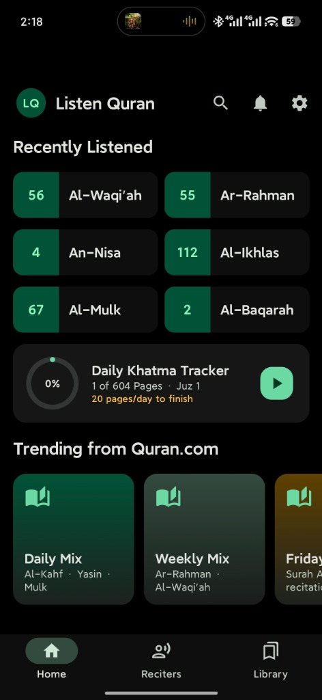
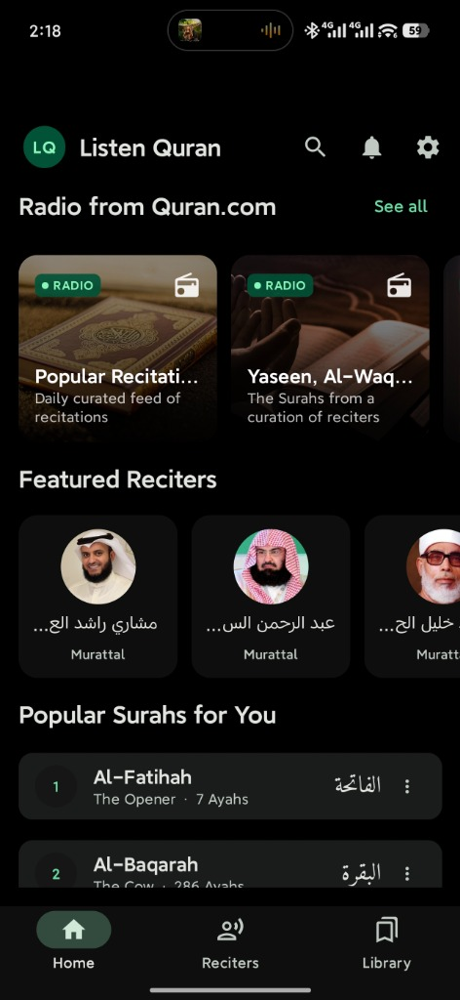
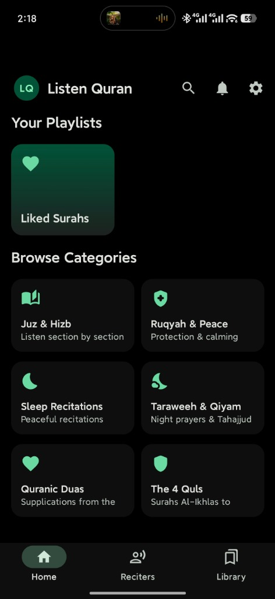
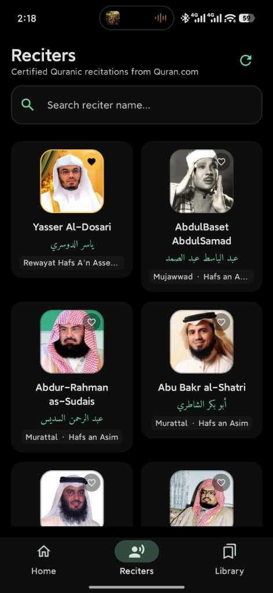
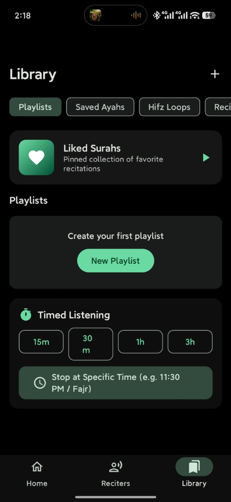

<div align="center">
  
  <h1>Listen Quran — استمع للقرآن</h1>
  <p><em>A modern, native Android offline-first Quran audio streaming and study application inspired by Spotify and Quran Audio.</em></p>

  <p>
    <a href="https://github.com/tokitauhid/listen-quran/releases/latest"></a>
    
    
    
    
    
    
  </p>
</div>

---

**Listen Quran** is a data-dense, offline-first Quran recitation and memorization companion built with Jetpack Compose, Material Design 3, and Jetpack Media3. Designed with 100% on-device data sovereignty, it combines Spotify-style fluid navigation with authentic Arabic calligraphy, continuous live radio streams, gapless audio playback, and a self-healing Khatam progress tracker.

## 📱 App Screenshots

<div align="center">
  <table>
    <tr>
      <td align="center" width="20%">
        <br />
        <sub><b>Home & Khatma Tracker</b></sub>
      </td>
      <td align="center" width="20%">
        <br />
        <sub><b>Continuous Radio Streams</b></sub>
      </td>
      <td align="center" width="20%">
        <br />
        <sub><b>Curated Categories</b></sub>
      </td>
      <td align="center" width="20%">
        <br />
        <sub><b>255+ Verified Reciters</b></sub>
      </td>
      <td align="center" width="20%">
        <br />
        <sub><b>Library & Sleep Timer</b></sub>
      </td>
    </tr>
  </table>
</div>

---

## ✨ Features

- 📖 **Durable Khatam Tracker** — Single source of truth across all 6,236 Ayahs. Physically isolated SQLite database (`khatam.db`) with append-only event sourcing (`khatam_events`), self-repairing snapshots (`khatam_snapshots`), 30-Juz visual completion grid, and automated background playback tracking (80% duration rule).
- 📻 **Continuous Quran.com Radio** — Non-stop recitation broadcasts streamed directly from Quran.com / QuranicAudio open CDN with resilient 10-second watchdog auto-reconnect and state protection for your last-played surah.
- 🎧 **Modern Media3 Audio Engine** — Built on Jetpack Media3 (`ExoPlayer` + `AudioPlayerManager` + `MediaLibraryService`). Features a floating M3 mini-player with shared-element expansion, gapless playback, lockscreen controls, and Android Auto integration.
- 🎙️ **255+ Verified CDN Reciters** — High-fidelity audio streams and offline downloads from Quran.com across multiple riwayahs (Hafs, Warsh, Qalun, Mujawwad, Murattal).
- 📜 **Lyrics-Style Synchronized Ayahs** — Karaoke-style real-time verse tracking with English translation, word-by-word highlight mode, tap-to-seek, and Amiri Quran Uthmani calligraphy with generous 2.2 line-height spacing.
- 🔁 **Hifz Repetition Engine** — Flexible memorization loops with custom ayah ranges ($A \to B$), configurable repetitions ($1\times, 3\times, 5\times, \infty$), and custom inter-verse pause intervals.
- ⏱️ **Timed Listening (Sleep Timer)** — Quick presets (15m, 30m, 1h, 3h, End of Surah) and exact target stop times (e.g. stop at 11:30 PM or Fajr).
- 🔍 **Instant Search & Dense Catalog** — Instant 1-tap `Surah:Ayah` parser (e.g. `2:255` for *Ayatul Kursi*), pre-packaged Room SQLite with standard SQL `LIKE` filtering, quick-assist chips, and browsable dense Surah grid.
- 🛡️ **Zero Accounts, 100% Privacy** — Complete on-device data sovereignty. Export and import your playlists, bookmarks, and listening stats as clean JSON via Android Storage Access Framework (SAF).

### 🚧 Coming Soon
- 🌐 **Word-by-Word Audio Sync** — Micro-timestamps for granular word-level pronunciation practice.
- 📱 **Home Screen Glance Widgets** — Interactive playback controls and Khatma progress directly on your Android launcher.

---

## 🛠️ Tech Stack

| Layer | Technology |
|---|---|
| **UI Framework** | Jetpack Compose + Material Design 3 (`1.3.1` via BOM `2024.12.01`) |
| **Language** | 100% Kotlin `2.1.0` (Coroutines, StateFlow, Unidirectional Data Flow) |
| **Audio Architecture** | Jetpack Media3 `1.5.1` (`ExoPlayer` + `MediaLibraryService` + `MediaSession`) |
| **Local Database** | Room Database `2.6.1` (`listen_quran.db` pre-pack + `khatam.db` isolated) |
| **Preferences** | Jetpack DataStore Preferences `1.1.1` |
| **Dependency Injection** | Dagger Hilt `2.53.1` |
| **Networking & Serialization** | Retrofit `2.11.0` + OkHttp `4.12.0` + Moshi `1.15.1` (KSP Codegen) |
| **Image Loading** | Coil Compose `2.7.0` |
| **Lists & Drag-and-Drop** | `sh.calvin.reorderable` `2.4.1` + Paging 3 |
| **Background Processing** | Jetpack WorkManager `2.10.0` |
| **Typography** | King Fahd Complex / Amiri Quran Uthmani Calligraphy (`.ttf`) |

---

## 🚀 Getting Started

### Prerequisites
- **JDK**: Java Development Kit 17 or higher
- **Android SDK**: Compile SDK `35`, Min SDK `26`
- **IDE**: Android Studio Ladybug (2024.2.1+) or command-line build tools

### 1. Clone the Repository
```bash
git clone git@github.com:tokitauhid/listen-quran.git
cd listen-quran
```

### 2. Build the Application

**Debug Build**:
```bash
./gradlew assembleDebug
```
*Output: `app/build/outputs/apk/debug/app-debug.apk`*

**Release Build (Minified with R8 & Shrink Resources)**:
```bash
./gradlew assembleRelease
```
*Output: `app/build/outputs/apk/release/app-release.apk`*

### 3. Run Unit & Durability Tests
```bash
./gradlew testDebugUnitTest
```

### 4. Install onto Connected Device / Emulator
```bash
# Debug:
./gradlew installDebug

# Release:
adb install -r app/build/outputs/apk/release/app-release.apk
```

---

## 📱 Building for Mobile

### Option 1: Automated Release Build & ADB Deployment (CLI)
Build an optimized production release APK with full R8 optimization, resource shrinking, and baseline profiles:
```bash
./gradlew assembleRelease
adb install -r app/build/outputs/apk/release/app-release.apk
```

### Option 2: Android Studio Workflow
1. Open the repository root directory in Android Studio.
2. Allow Gradle sync to complete and download dependencies.
3. Select the `app` run configuration and choose your connected physical device or emulator.
4. Click **Run** (`Shift + F10`) or **Build > Generate Signed Bundle / APK**.

---

## 📦 Releasing & Versioning

Listen Quran uses automated GitHub Actions workflows triggered on semantic version tags (`v*`):

```bash
# 1. Update version in app/build.gradle.kts (versionCode & versionName)
# 2. Commit and create an annotated git tag:
git tag -a v1.0.0 -m "Release v1.0.0"

# 3. Push tag to GitHub:
git push origin v1.0.0
```

The GitHub Actions workflow ([`.github/workflows/release.yml`](.github/workflows/release.yml)) will automatically:
1. Check out code and set up JDK 17.
2. Build the minified, production-ready release APK via `./gradlew assembleRelease`.
3. Publish a GitHub Release attaching `app-release.apk` with auto-generated release notes.

---

## 🙏 Credits & Attribution

- **[Quran.com / Quran Foundation](https://quran.com)** — Open data APIs, chapter metadata, translations, and high-fidelity recitation audio CDN via QuranicAudio.
- **[Amiri Font Project](https://github.com/aliftype/amiri)** — Authentic Uthmani Quranic Arabic typography designed by Dr. Khaled Hosny and Dr. Nezar Al-Rawi.
- **[Quran Audio & Batoul Apps](https://github.com/batoulapps)** — Inspiration for clean, offline-first Islamic software engineering.

---

## 📄 Licence

MIT — see [LICENSE](./LICENSE) for details.
